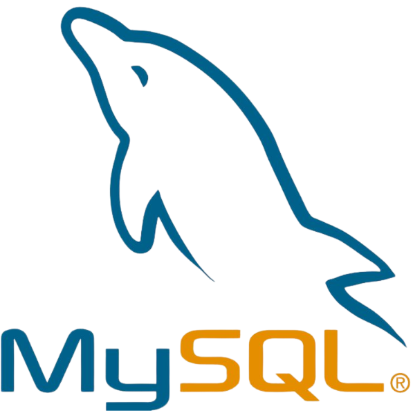
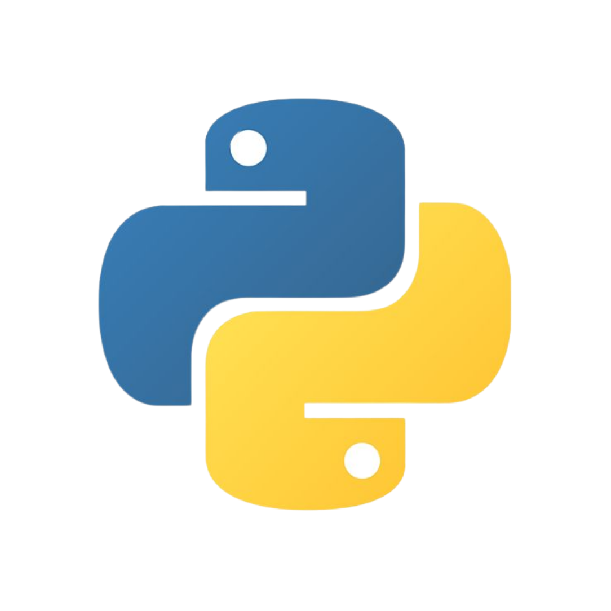
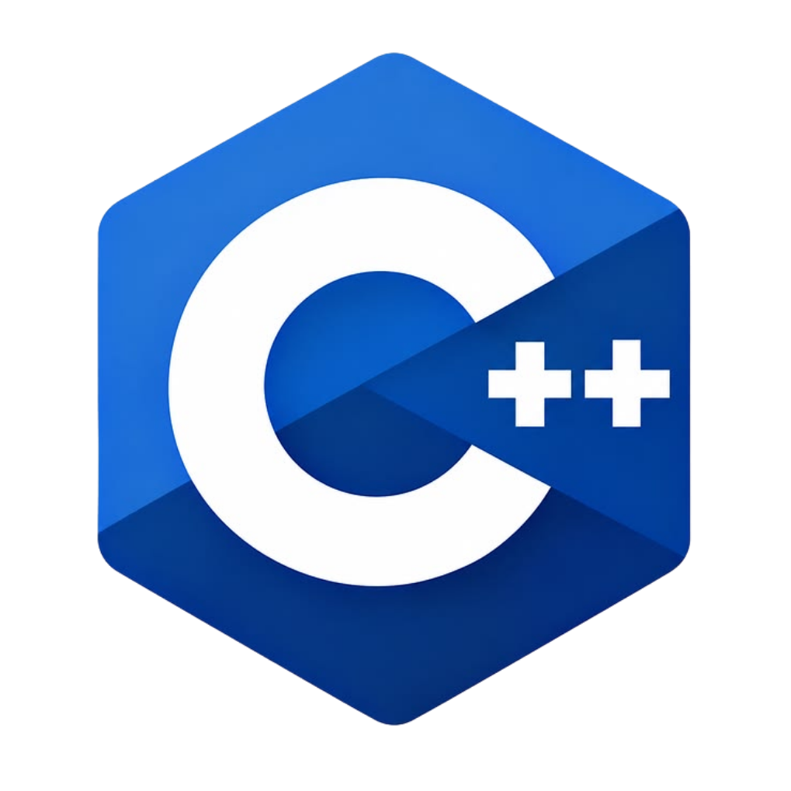
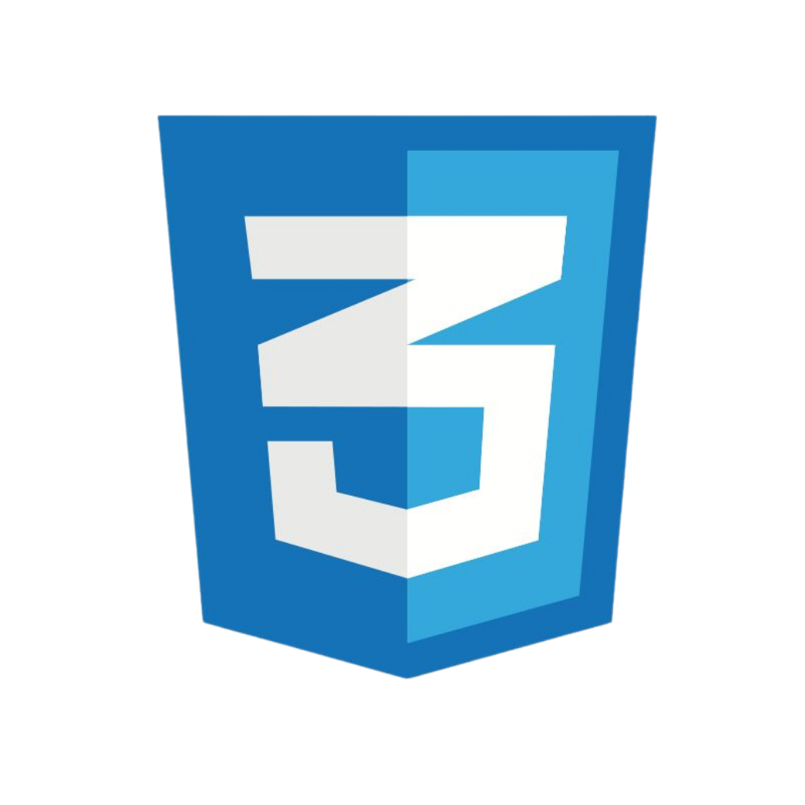
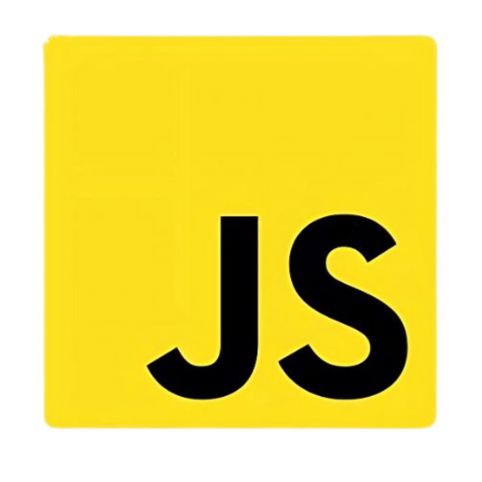

  

  <b>Lukas Rivaldo Harahap</b>

<h3 data-importer="text" align="center">About Me</h3>

Hello, my name is Lukas Rivaldo Harahap. You can call me VAL. I am a developer and visual designer from Indonesia who operates under the personal brand VAL. My creative philosophy centers on uniting minimalist brand identity with clean, structured software engineering. I enjoy transforming abstract concepts into sharp visual systems and responsive user interfaces. Every project I build is driven by a strong attention to detail, typography, and modern aesthetics. On the technical side, I craft interactive front-end web experiences using HTML, CSS, and Vanilla JavaScript. I also write Python scripts to automate workflows and build practical, everyday digital utilities. In addition, I explore the fundamentals of C++ to understand how programs work under the hood. Combining visual design tools with code allows me to handle both the look and the logic of a product seamlessly. Right now, I am actively expanding my GitHub portfolio with open-source tools and creative web applications. Feel free to explore my repositories or reach out if you would like to collaborate on an exciting project.

<h3 data-importer="text" align="center">Find Me On</h3>

  
  
  

<h3 data-importer="text" align="center">Tech Stack</h3>

  
  
  
  
  
  

<h3 data-importer="text" align="center">Tech Being Studied</h3>

  
  

